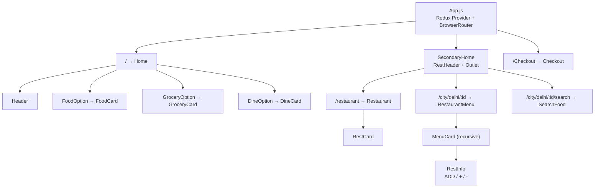
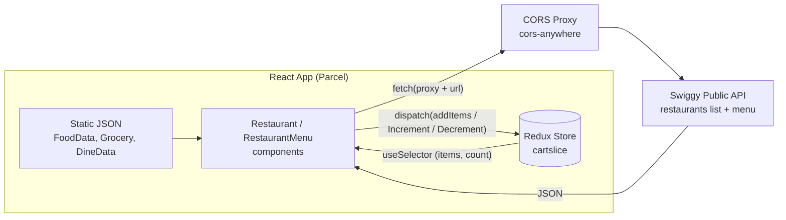
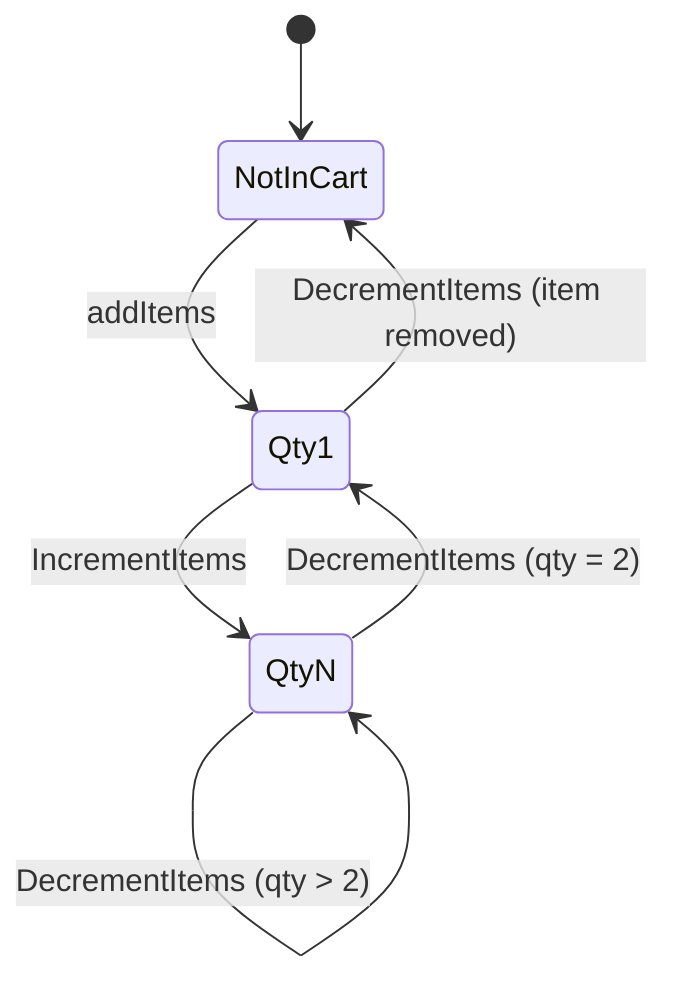

<div align="center">

# 🍔 QuickBite: Food Delivery Platform

**A Swiggy-inspired food delivery frontend with live restaurant data, nested menus, veg / non-veg filtering and a Redux-powered cart.**


[Report Bug](https://github.com/naveenpachahara/QuickBite-Food-Delivery-Platform/issues) · [Request Feature](https://github.com/naveenpachahara/QuickBite-Food-Delivery-Platform/issues)

</div>

---

## 📖 About

QuickBite is a frontend food delivery application built with **React 19, Redux Toolkit, React Router 7 and Tailwind CSS 4**. It recreates the core ordering journey of a modern food delivery app: discover restaurants, open a menu, filter by veg / non-veg, add dishes to a cart and head to checkout.

Restaurant listings and menus are fetched **live** from Swiggy's public web endpoints (through a CORS proxy), so the app works with real-world, deeply nested API data rather than hand-made mock JSON.

> ⚠️ **Disclaimer:** This is an educational / portfolio project. It is **not affiliated with, endorsed by, or connected to Swiggy**. All brand names, logos and data belong to their respective owners.

---

## ✨ Features

### 🏠 Home
- Landing page with hero header and quick-access banners (Food, Instamart, Dineout, Genie)
- **"What's on your mind"** food category grid
- **Instamart grocery** categories in a horizontally scrolling row
- **Dineout** restaurant carousel with images, ratings and offers

### 🍽️ Restaurant Discovery
- Live list of restaurants (Delhi) fetched from the API
- Cards showing image, rating, delivery time and cuisines
- Shimmer loading skeleton while data loads

### 📋 Restaurant Menu
- Dynamic menu page per restaurant (`/city/delhi/:id`)
- Handles **nested categories** with recursive rendering
- **Collapsible** menu sections
- **Veg / Non-veg filter** toggle
- Dish cards with price, rating, description and image

### 🛒 Cart (Redux Toolkit)
- **ADD** button turns into a `- qty +` stepper
- Increment / decrement quantity, and the item is removed when quantity reaches zero
- Live cart count in the header
- Cart state shared across all pages

### 💳 Checkout
- Dedicated `/Checkout` route that reads the cart from the Redux store

---

## 🛠️ Tech Stack

| Layer | Technology |
| --- | --- |
| **UI Library** | React 19 |
| **State Management** | Redux Toolkit, React-Redux |
| **Routing** | React Router 7 (nested routes + `Outlet`) |
| **Styling** | Tailwind CSS 4 (via PostCSS) |
| **Icons** | Lucide React |
| **Bundler / Dev Server** | Parcel 2 |
| **Data** | Swiggy public web API + static JSON modules |

---

## 📁 Project Structure

```
QuickBite-Food-Delivery-Platform/
│
├── App.js                # Entry point: Provider, Router, routes
├── index.html
├── index.css
├── .postcssrc            # Tailwind PostCSS plugin config
│
├── Home.js               # Landing page
├── Header.js             # Hero header
├── SecondaryHome.js      # Layout wrapper (RestHeader + Outlet)
├── RestHeader.js         # Top bar with live cart count
│
├── Restaurant.js         # Restaurant listing (API)
├── RestCard.js           # Restaurant card
├── RestaurantMenu.js     # Menu page (API) + veg / non-veg filter
├── MenuCard.js           # Recursive menu category renderer
├── RestInfo.js           # Dish card with ADD / + / - controls
├── SearchFood.js         # Dish search page
│
├── FoodOption.js · FoodCard.js · FoodData.js         # Food category grid
├── GroceryOption.js · GroceryCard.js · Grocery.js    # Grocery categories
├── DineOption.js · DineCard.js · DineData.js         # Dineout carousel
│
├── CartSlicer.js         # Redux cart slice
├── stores.js             # Redux store
├── Checkout.js           # Checkout page
└── Shimmer.js            # Loading skeleton
```

---

## 🏗️ Architecture

### Component & Route Tree



### Data Flow



### Cart State Machine



### Key Design Decisions

- **Recursive rendering**: `MenuCard` renders itself for nested categories, so any menu depth from the API is handled.
- **Centralized cart**: one Redux slice (`items[]` + `count`) keeps the header counter, dish cards and checkout always in sync.
- **Layout routes**: `SecondaryHome` uses React Router's `Outlet` so all inner pages share one header.
- **Defensive data access**: optional chaining throughout to survive the API's deeply nested and changing response shape.
- **Hybrid data**: live API for restaurants and menus, static JSON modules for home-page sections.

---

## 🚀 Getting Started

### Prerequisites
- [Node.js](https://nodejs.org/) v18 or higher
- npm

### Installation

```bash
# 1. Clone the repository
git clone https://github.com/naveenpachahara/QuickBite-Food-Delivery-Platform.git

# 2. Go into the project folder
cd QuickBite-Food-Delivery-Platform

# 3. Install dependencies
npm install

# 4. Start the dev server
npm start
```

Parcel will print a local URL (by default **http://localhost:1234**).

### 🔓 Enabling live restaurant data

The app calls the API through the public `cors-anywhere` proxy, which requires a one-time manual opt-in:

1. Open **https://cors-anywhere.herokuapp.com/corsdemo**
2. Click **"Request temporary access to the demo server"**
3. Reload the app

Without this step, the Restaurant and Menu pages will stay on the loading shimmer.

### Production build

```bash
npm run build
```

The output is generated in the `dist/` folder.

---

## 🧭 Routes

| Route | Page |
| --- | --- |
| `/` | Home (food, grocery and dineout sections) |
| `/restaurant` | Restaurant listing |
| `/city/delhi/:id` | Restaurant menu |
| `/city/delhi/:id/search` | Search dishes in a restaurant |
| `/Checkout` | Cart / checkout |

---

## 🧰 NPM Scripts

| Script | Description |
| --- | --- |
| `npm start` | Start Parcel dev server |
| `npm run build` | Create production build in `dist/` |

---

## 🗺️ Roadmap

- [ ] Working dish search and filtering on the search page
- [ ] Full checkout: item prices, quantity controls, bill total, taxes and delivery fee
- [ ] Persist cart in `localStorage`
- [ ] Replace the public CORS proxy with a small Node/Express backend proxy
- [ ] Location selector instead of fixed Delhi coordinates
- [ ] Working search bar on the home page
- [ ] Rename the `/Checkout` route to lowercase `/checkout`
- [ ] User authentication and order history
- [ ] Payment gateway integration
- [ ] Error states and an empty-cart screen
- [ ] Deployment (Vercel / Netlify) with a live demo link

---

## 🧠 What I Learned

- Structuring a React app into small reusable components
- Global state with Redux Toolkit (slices, actions, selectors)
- Nested and layout routes with React Router 7
- Consuming and safely navigating large, deeply nested API responses
- Recursive component rendering
- Handling CORS with a proxy
- Loading states with shimmer UI
- Styling with Tailwind CSS 4

---

## 🤝 Contributing

1. Fork the project
2. Create a branch: `git checkout -b feature/amazing-feature`
3. Commit your changes: `git commit -m "Add amazing feature"`
4. Push the branch: `git push origin feature/amazing-feature`
5. Open a Pull Request

---

## 👤 Author

**Naveen Pachahara**
B.Tech Computer Science Engineering · Full Stack / MERN Developer

GitHub: [@naveenpachahara](https://github.com/naveenpachahara)

---

<div align="center">

⭐ If you found this project useful, please give it a star!

*Built for learning and portfolio purposes.*

</div>
